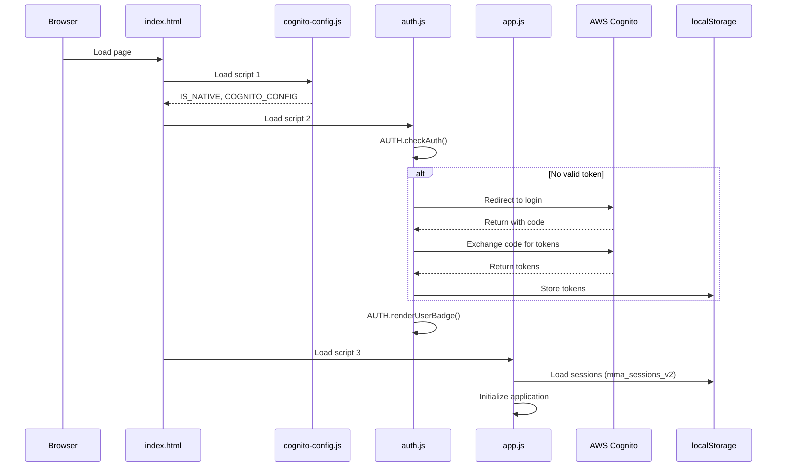
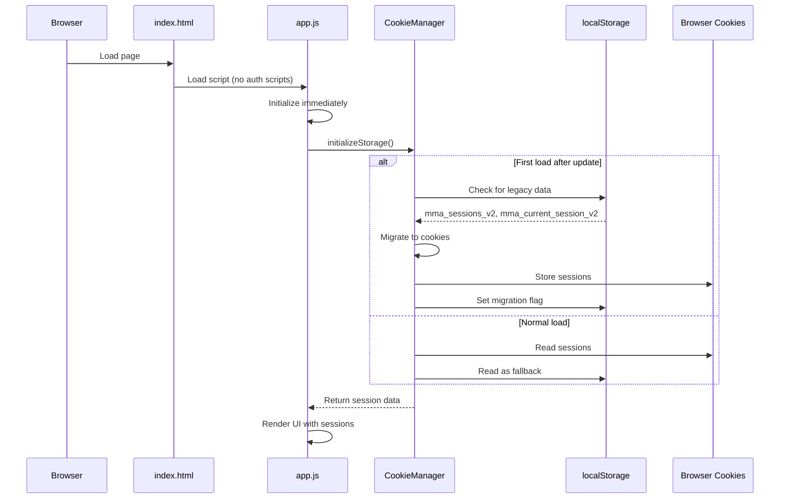

# Design Document: Remove Cognito Authentication

## Overview

This design specifies the removal of AWS Cognito authentication from the AWS Security Maturity Model Assessment Tool and its replacement with a cookie-based session persistence system. The current application uses Cognito for user authentication with PKCE flow, loading auth.js and cognito-config.js before app initialization. This design eliminates all authentication requirements, allowing direct application access while maintaining the existing multi-session functionality that currently uses localStorage.

### Goals

1. **Eliminate external authentication dependency**: Remove all Cognito-related code, configuration, and UI elements
2. **Simplify application bootstrap**: Remove authentication checks from the startup sequence
3. **Maintain session functionality**: Preserve all existing session management features (create, switch, delete, export)
4. **Add cookie persistence**: Supplement localStorage with cookie-based storage for enhanced persistence
5. **Ensure backward compatibility**: Migrate existing localStorage data to the new system without data loss
6. **Preserve all features**: Maintain 100% feature parity with the authenticated version

### Non-Goals

1. User account management or multi-user support
2. Server-side session storage or backend integration
3. Session encryption or advanced security features
4. Cross-device session synchronization
5. Native mobile app functionality (Capacitor integration)


## Architecture

### Current Architecture



**Key characteristics of current architecture:**

- **Sequential loading**: cognito-config.js → auth.js → app.js (strict order dependency)
- **Blocking authentication**: AUTH.checkAuth() must complete before app initialization
- **PKCE flow implementation**: ~200 lines of OAuth code including code verifier, challenge generation, token exchange
- **Dual storage**: Cognito tokens in localStorage + session data in localStorage
- **Native platform detection**: IS_NATIVE flag determines web vs Android behavior
- **User badge UI**: Email display and sign-out button rendered in header

### Proposed Architecture




**Key improvements in proposed architecture:**

- **Direct initialization**: Application loads immediately without authentication checks
- **Dual persistence**: Cookies as primary storage with localStorage fallback
- **Migration path**: Automatic one-time migration from localStorage to cookies
- **Simplified bootstrap**: Single script load (app.js) instead of three sequential scripts
- **No external dependencies**: Zero network calls to authentication providers
- **Backward compatible**: Existing sessions automatically migrate

### Bootstrap Sequence Comparison

#### Old Bootstrap (with Cognito)

```javascript
// 1. cognito-config.js loads
const IS_NATIVE = !!(window.Capacitor?.isNativePlatform?.());
const COGNITO_CONFIG = { domain, clientId, redirectUri, scopes };

// 2. auth.js loads and executes IIFE
(async () => {
  let userInfo = null;
  try {
    userInfo = await AUTH.checkAuth();  // May redirect to Cognito
  } catch (err) {
    console.error('[Auth] Bootstrap error:', err);
  }
  AUTH.renderUserBadge(userInfo);
})();

// 3. Only after auth completes, app.js loads
function loadSessions() { /* ... */ }
// App continues...
```


#### New Bootstrap (no authentication)

```javascript
// app.js loads immediately, no dependencies
(async function initApp() {
  try {
    // Initialize cookie-based storage
    CookieManager.initialize();
    
    // Load assessment data
    await loadData();
    
    // Load sessions (from cookies + localStorage fallback)
    loadSessions();
    
    // Render UI
    render();
    buildCapNav();
    updateScores();
    
    // Remove loading screen
    hideLoadingScreen();
  } catch (error) {
    showFatalError(error);
  }
})();
```


## Components and Interfaces

### Files to Remove

| File | Lines | Purpose | Reason for Removal |
|------|-------|---------|-------------------|
| `js/auth.js` | 320 | PKCE OAuth flow, token management, Capacitor integration | No longer needed without authentication |
| `js/cognito-config.js` | 25 | Cognito domain, client ID, redirect URI configuration | No authentication provider |
| `css/auth.css` | ~50 | User badge and sign-out button styles | No authentication UI |
| `CognitoSetup.md` | ~100 | Documentation for Cognito setup | Obsolete |

### Files to Modify

#### 1. `index.html`

**Changes required:**

```diff
  <link rel="stylesheet" href="css/styles.css">
- <link rel="stylesheet" href="css/auth.css">
  <link rel="stylesheet" href="css/print.css">
```

```diff
  <script src="https://cdn.jsdelivr.net/npm/@highlightjs/cdn-assets@11/highlight.min.js"></script>
  <script src="https://cdn.jsdelivr.net/npm/marked@12/lib/marked.umd.min.js"></script>
- <script src="js/cognito-config.js"></script>
- <script src="js/auth.js"></script>
  <script src="js/app.js"></script>
  <script src="js/print.js"></script>
```

**Impact**: Removes 2 script tags and 1 stylesheet link. Header section remains unchanged except for the removal of dynamically injected auth UI elements.


#### 2. `js/app.js`

**Changes required:**

1. **Remove AUTH references**: No calls to `AUTH.checkAuth()` or `AUTH.renderUserBadge()`
2. **Add CookieManager module**: New cookie management functions
3. **Update session loading**: Load from cookies first, localStorage as fallback
4. **Add migration logic**: One-time migration of existing localStorage data to cookies

**Current session management structure**:

```javascript
// Current implementation (localStorage only)
const STORAGE_KEY = 'mma_sessions_v2';
const CURRENT_SESSION_KEY = 'mma_current_session_v2';
let sessions = {};                    // Object keyed by sessionId
let currentSessionId = null;          // String: active session ID

// Session structure
{
  id: 'session_1234567890_abc123',
  name: 'Q4 2024 Assessment',
  date: '2024-01-15T10:30:00.000Z',
  isDefault: false,
  scores: { 'p0_c0': 0.75, ... },     // Map of itemId -> score
  comments: { 'p0_c0': 'Note', ... }  // Map of itemId -> comment
}
```

#### 3. `CLAUDE.md`

**Changes required:**

```diff
  ## Authentication
- The application uses AWS Cognito for authentication with PKCE flow.
- On load, auth.js performs authentication check before app initialization.
- User email is displayed in header badge with sign-out functionality.
+ The application requires no authentication.
+ Sessions are stored in browser cookies with localStorage fallback.
+ All data is stored locally in the user's browser.
```

**Impact**: Update architecture documentation to reflect removal of authentication layer.

#### 4. `CognitoSetup.md`

**Options:**

1. **Option A (Recommended)**: Delete the file entirely
2. **Option B**: Add deprecation notice at top:

```markdown
# ⚠️ DEPRECATED

This document is no longer relevant. Authentication has been removed from the application as of version X.X.
Sessions are now managed using browser cookies and localStorage.
```


### New Component: CookieManager

The CookieManager module provides cookie-based storage with localStorage fallback. It will be implemented as an IIFE module in `app.js`.

```javascript
const CookieManager = (() => {
  const COOKIE_NAME = 'mma_sessions';
  const COOKIE_EXPIRY_DAYS = 365;
  const MAX_COOKIE_SIZE = 4096; // 4KB browser limit
  const MIGRATION_FLAG = 'mma_cookie_migration_complete';

  // Public API
  return {
    initialize,
    getSessions,
    saveSessions,
    getCurrentSessionId,
    saveCurrentSessionId,
    checkMigrationNeeded,
    performMigration
  };
})();
```

**Interface:**

```typescript
interface CookieManager {
  // Initialize storage system (checks migration, sets up fallback)
  initialize(): void;
  
  // Read all sessions from cookies (fallback to localStorage)
  getSessions(): { [sessionId: string]: Session };
  
  // Write all sessions to cookies (and localStorage backup)
  saveSessions(sessions: { [sessionId: string]: Session }): boolean;
  
  // Read current session ID from cookie
  getCurrentSessionId(): string | null;
  
  // Write current session ID to cookie
  saveCurrentSessionId(sessionId: string): boolean;
  
  // Check if migration from localStorage to cookies is needed
  checkMigrationNeeded(): boolean;
  
  // Perform one-time migration from localStorage to cookies
  performMigration(): boolean;
}
```


## Data Models

### Session Model

No changes to the existing session data structure:

```typescript
interface Session {
  id: string;                    // Unique identifier (e.g., "session_1704201234567_abc")
  name: string;                  // User-provided name (e.g., "Q4 2024 Assessment")
  date: string;                  // ISO 8601 timestamp (e.g., "2024-01-15T10:30:00.000Z")
  isDefault?: boolean;           // Optional flag for default session
  scores: { [itemId: string]: number | 'na' };  // Assessment scores (0-1 or 'na')
  comments: { [itemId: string]: string };       // User comments per item
}
```

**Example:**

```json
{
  "session_1704201234567_abc": {
    "id": "session_1704201234567_abc",
    "name": "Production Environment Assessment",
    "date": "2024-01-15T10:30:00.000Z",
    "isDefault": false,
    "scores": {
      "p0_c0": 1,
      "p0_c1": 0.75,
      "p1_c0": 0.5,
      "p1_c1": "na"
    },
    "comments": {
      "p0_c0": "Fully implemented with CloudTrail",
      "p0_c1": "GuardDuty enabled but needs tuning"
    }
  }
}
```


### Cookie Storage Format

Cookies will store serialized JSON with compression considerations:

```typescript
// Cookie 1: All sessions data
{
  name: "mma_sessions",
  value: JSON.stringify(sessions),  // Serialized sessions object
  expires: 365 days from now,
  path: "/",
  sameSite: "Lax"
}

// Cookie 2: Current session ID
{
  name: "mma_current_session",
  value: sessionId,                 // Plain string
  expires: 365 days from now,
  path: "/",
  sameSite: "Lax"
}
```

**Size management strategy:**

- Average session size: ~2KB (10 items scored with comments)
- Maximum 2 sessions in cookie storage before size warning
- If cookie write fails due to size:
  1. Keep only current session + 1 most recent in cookies
  2. Store remaining sessions in localStorage only
  3. Display warning to user: "Cookie storage limit reached. Consider exporting older sessions."

### LocalStorage Schema (Unchanged)

```typescript
// Key: "mma_sessions_v2"
// Value: JSON string of sessions object
{
  "session_123": { ...session data... },
  "session_456": { ...session data... }
}

// Key: "mma_current_session_v2"
// Value: Plain string session ID
"session_123"

// Key: "mma_cookie_migration_complete"
// Value: "true" or timestamp
"2024-01-15T10:30:00.000Z"
```


## Correctness Properties

*A property is a characteristic or behavior that should hold true across all valid executions of a system—essentially, a formal statement about what the system should do. Properties serve as the bridge between human-readable specifications and machine-verifiable correctness guarantees.*

### Property Reflection

After reviewing all acceptance criteria, the following properties were identified as testable through property-based testing. Several redundant or overlapping properties were consolidated:

**Consolidated properties:**
- Properties 2.2 (preserve data structure) and 6.4 (preserve data during migration) both test data preservation → combined into Property 1
- Properties 2.4 (unique IDs) and 2.5 (correct session loading) both test session integrity → kept separate as they test different aspects
- Property 3.2 (serialize multiple sessions) and Property 6.2 (migrate sessions) both test serialization → combined into Property 2

**Final property set covers:**
1. Data preservation (round-trip serialization)
2. Session uniqueness (ID generation)
3. Session isolation (switching doesn't corrupt data)
4. Size monitoring accuracy
5. Priority preservation (recent sessions kept on size limit)


### Property 1: Session Data Preservation

*For any* set of sessions with valid session data structures (id, name, date, scores, comments), serializing to storage format and then deserializing SHALL produce equivalent session objects with all fields preserved.

**Validates: Requirements 2.2, 6.4**

**Rationale:** This is a round-trip property ensuring that the serialization format (JSON for cookies, localStorage) preserves all session fields. Any data corruption during serialize/deserialize cycles will be caught.

**Test strategy:** Generate random sessions with varying numbers of scores and comments. Serialize and deserialize through CookieManager. Assert all fields match original.

### Property 2: Multi-Session Storage

*For any* collection of sessions (from 1 to N sessions), the storage system SHALL be able to serialize all sessions to storage format and deserialize them back to an equivalent collection.

**Validates: Requirements 2.1, 3.2, 6.2**

**Rationale:** This property ensures that the storage system can handle multiple sessions without data loss or corruption, whether storing to cookies or localStorage. It covers both normal operation and migration scenarios.

**Test strategy:** Generate random numbers of sessions (1-10). Store via CookieManager. Retrieve and verify all sessions are present with correct data.


### Property 3: Session ID Uniqueness

*For any* number of session creation operations, all generated session IDs SHALL be unique.

**Validates: Requirements 2.4**

**Rationale:** Session IDs must be globally unique to prevent data corruption when switching between sessions. The ID generation algorithm (timestamp + random) should never produce collisions.

**Test strategy:** Generate N sessions (100+) in rapid succession. Assert that all session IDs in the resulting collection are unique.

### Property 4: Session Switching Isolation

*For any* two distinct sessions A and B, switching from session A to session B and back to session A SHALL restore session A's data exactly as it was before the switch.

**Validates: Requirements 2.5**

**Rationale:** This is a round-trip property at the session level. Switching sessions should not corrupt or mix data between sessions. Each session must maintain isolation.

**Test strategy:** Create two sessions with different scores and comments. Switch A→B→A. Assert A's data matches original. Repeat with random session data.


### Property 5: Storage Size Monitoring Accuracy

*For any* session data of known serialized size, the size monitoring function SHALL return a value within 5% of the actual serialized size.

**Validates: Requirements 8.1**

**Rationale:** Accurate size monitoring is critical for warning users before hitting browser cookie limits. The monitoring function must reliably predict the actual storage size.

**Test strategy:** Generate sessions of varying sizes (small: 1KB, medium: 2KB, large: 4KB). Call size monitoring function. Compare reported size to actual `JSON.stringify(sessions).length`. Assert within 5% tolerance.

### Property 6: Priority Preservation on Size Limit

*For any* set of sessions ordered by date, if storage size exceeds limits, the N most recent sessions (by date) SHALL be preserved in the reduced storage.

**Validates: Requirements 8.4**

**Rationale:** When cookie storage limits are reached, the system must intelligently prune older sessions while keeping recent work. This property ensures the prioritization algorithm correctly orders by date.

**Test strategy:** Generate 5+ sessions with random dates. Mock a size limit violation. Trigger size reduction logic. Assert that sessions remaining in storage are the N most recent by date field.


## Error Handling

### Cookie Write Failures

**Scenario**: Browser cookie storage exceeds 4KB limit

**Detection**: `document.cookie = ...` silently fails in most browsers

**Handling strategy**:

```javascript
function setCookie(name, value, days) {
  const expires = new Date(Date.now() + days * 864e5).toUTCString();
  const cookieString = `${name}=${value}; expires=${expires}; path=/; SameSite=Lax`;
  
  // Attempt write
  document.cookie = cookieString;
  
  // Verify write succeeded
  const written = getCookie(name);
  if (written !== value) {
    // Cookie write failed - likely size limit
    handleCookieWriteFailure(name, value);
    return false;
  }
  return true;
}

function handleCookieWriteFailure(name, value) {
  // 1. Calculate actual size
  const size = new Blob([value]).size;
  
  if (size > MAX_COOKIE_SIZE) {
    // 2. Implement pruning strategy
    const sessions = JSON.parse(value);
    const pruned = keepMostRecent(sessions, 2);  // Keep current + 1 most recent
    
    // 3. Retry with pruned data
    const success = setCookie(name, JSON.stringify(pruned), 365);
    
    if (success) {
      // 4. Show warning to user
      showStorageWarning();
    } else {
      // 5. Fall back to localStorage only
      fallbackToLocalStorage(sessions);
    }
  }
}
```


### Migration Failures

**Scenario**: localStorage data is corrupted or unparseable

**Detection**: `JSON.parse()` throws exception

**Handling strategy**:

```javascript
function performMigration() {
  try {
    const sessionsRaw = localStorage.getItem(STORAGE_KEY);
    const currentRaw = localStorage.getItem(CURRENT_SESSION_KEY);
    
    if (!sessionsRaw) {
      // No data to migrate - normal first-time use
      localStorage.setItem(MIGRATION_FLAG, new Date().toISOString());
      return true;
    }
    
    const sessions = JSON.parse(sessionsRaw);  // May throw
    const currentId = currentRaw || Object.keys(sessions)[0];
    
    // Attempt cookie write
    const success = saveSessions(sessions) && saveCurrentSessionId(currentId);
    
    if (success) {
      localStorage.setItem(MIGRATION_FLAG, new Date().toISOString());
      return true;
    } else {
      // Cookie write failed - keep using localStorage
      console.warn('Migration failed: cookie write error. Continuing with localStorage.');
      return false;
    }
  } catch (error) {
    console.error('Migration failed:', error);
    // Corrupted data - start fresh
    createDefaultSession();
    localStorage.setItem(MIGRATION_FLAG, new Date().toISOString());
    return false;
  }
}
```


### Cookies Disabled

**Scenario**: User has disabled cookies in browser settings

**Detection**: Cookie write fails verification check

**Handling strategy**:

```javascript
function initialize() {
  // Test cookie support
  const testCookie = 'mma_test';
  document.cookie = `${testCookie}=1; path=/`;
  const cookiesEnabled = document.cookie.indexOf(testCookie) !== -1;
  
  if (cookiesEnabled) {
    // Clean up test cookie
    document.cookie = `${testCookie}=; expires=Thu, 01 Jan 1970 00:00:00 GMT; path=/`;
  } else {
    console.warn('Cookies disabled. Using localStorage only.');
    // Set flag to skip cookie operations
    useCookies = false;
  }
  
  // Continue initialization
  if (checkMigrationNeeded()) {
    performMigration();
  }
}
```

**User impact**: Application works normally with localStorage only. No cookie persistence across browser clears, but localStorage persists until explicitly cleared.


### No Sessions Found

**Scenario**: Fresh installation with no localStorage and no cookies

**Detection**: Both storage mechanisms return null/empty

**Handling strategy**:

```javascript
function loadSessions() {
  try {
    // Try cookies first
    let sessions = CookieManager.getSessions();
    let currentId = CookieManager.getCurrentSessionId();
    
    // Fallback to localStorage
    if (!sessions || Object.keys(sessions).length === 0) {
      const raw = localStorage.getItem(STORAGE_KEY);
      if (raw) {
        sessions = JSON.parse(raw);
        currentId = localStorage.getItem(CURRENT_SESSION_KEY);
      }
    }
    
    // Still no data - create default
    if (!sessions || Object.keys(sessions).length === 0) {
      const defaultId = generateSessionId();
      sessions = {
        [defaultId]: {
          id: defaultId,
          name: 'Default Session',
          date: new Date().toISOString(),
          isDefault: true,
          scores: {},
          comments: {}
        }
      };
      currentId = defaultId;
      CookieManager.saveSessions(sessions);
      CookieManager.saveCurrentSessionId(currentId);
    }
    
    // Load into app state
    Object.assign(window.sessions, sessions);
    window.currentSessionId = currentId;
    loadCurrentSession();
  } catch (error) {
    console.error('Error loading sessions:', error);
    createDefaultSession();
  }
}
```


## Testing Strategy

### Overview

This feature requires a dual testing approach combining unit tests for specific scenarios and property-based tests for universal properties. The testing strategy focuses on:

1. **Data integrity**: Ensuring session data is preserved across storage operations
2. **Migration correctness**: Verifying existing users don't lose data
3. **Storage fallback**: Confirming localStorage works when cookies fail
4. **Size handling**: Testing behavior at storage limits
5. **Backward compatibility**: All existing features continue to work

### Unit Tests

Unit tests focus on specific examples, edge cases, and integration points:

**Cookie operations (10 tests)**:
- Write and read cookie with valid data
- Cookie expiration is set to 365 days
- Cookie path is set to "/"
- SameSite attribute is "Lax"
- Writing empty string to cookie
- Writing special characters (quotes, semicolons) to cookie
- Cookies disabled (document.cookie returns empty)
- Cookie size exceeds 4KB (write fails gracefully)
- Multiple rapid writes (last write wins)
- Reading non-existent cookie returns null


**Migration logic (8 tests)**:
- Migration runs on first load after update
- Migration flag prevents repeated migrations
- Existing localStorage data is copied to cookies
- Current session ID is migrated correctly
- Corrupted JSON in localStorage handled gracefully
- Empty localStorage creates default session
- Migration sets timestamp in flag
- Migration failure doesn't break app initialization

**File removal verification (5 tests)**:
- index.html doesn't contain "cognito-config.js" script tag
- index.html doesn't contain "auth.js" script tag
- index.html doesn't contain "auth.css" link tag
- AUTH global variable is undefined after load
- IS_NATIVE variable is undefined after load

**Integration tests (10 tests)**:
- Application loads without authentication
- No redirects to Cognito domain
- User badge is not rendered
- Sign-out button is not rendered
- All 74 assessment items load correctly
- Session creation works
- Session switching works
- CSV export works
- Print preview works
- All UI components render without errors


### Property-Based Tests

Property-based tests verify universal properties across randomized inputs. Using **fast-check** library for JavaScript property-based testing.

**Configuration**: Each property test must run minimum 100 iterations to ensure comprehensive input coverage.

**Test file structure**:

```javascript
// tests/cookie-manager.property.test.js
import fc from 'fast-check';
import { CookieManager } from '../js/app.js';

describe('CookieManager - Property-Based Tests', () => {
  
  test('Property 1: Session Data Preservation', () => {
    // Feature: remove-cognito-auth, Property 1: Session Data Preservation
    fc.assert(
      fc.property(
        sessionArbitrary(),  // Generator for random sessions
        (session) => {
          const serialized = JSON.stringify(session);
          const deserialized = JSON.parse(serialized);
          
          expect(deserialized.id).toBe(session.id);
          expect(deserialized.name).toBe(session.name);
          expect(deserialized.date).toBe(session.date);
          expect(deserialized.scores).toEqual(session.scores);
          expect(deserialized.comments).toEqual(session.comments);
        }
      ),
      { numRuns: 100 }
    );
  });

  // Additional property tests...
});
```


**Custom generators (arbitraries)**:

```javascript
// Generates random session objects
function sessionArbitrary() {
  return fc.record({
    id: fc.string({ minLength: 20, maxLength: 40 }),
    name: fc.string({ minLength: 1, maxLength: 50 }),
    date: fc.date().map(d => d.toISOString()),
    isDefault: fc.boolean(),
    scores: fc.dictionary(
      fc.string({ minLength: 4, maxLength: 10 }),  // itemId like "p0_c5"
      fc.oneof(fc.double({ min: 0, max: 1 }), fc.constant('na'))
    ),
    comments: fc.dictionary(
      fc.string({ minLength: 4, maxLength: 10 }),
      fc.string({ maxLength: 200 })
    )
  });
}

// Generates collection of sessions
function sessionsArbitrary() {
  return fc.array(sessionArbitrary(), { minLength: 1, maxLength: 10 })
    .map(sessions => {
      const obj = {};
      sessions.forEach(s => { obj[s.id] = s; });
      return obj;
    });
}
```

**Test library**: fast-check (https://github.com/dubzzz/fast-check)

**Installation**: `npm install --save-dev fast-check`

**Tag format**: Each test must include a comment with the format:
```javascript
// Feature: remove-cognito-auth, Property N: [Property Title]
```

